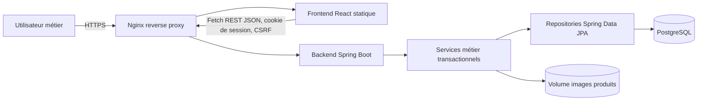
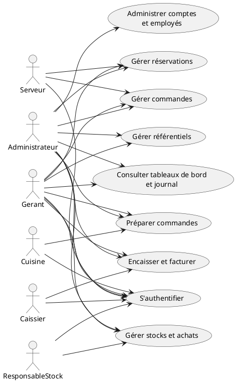
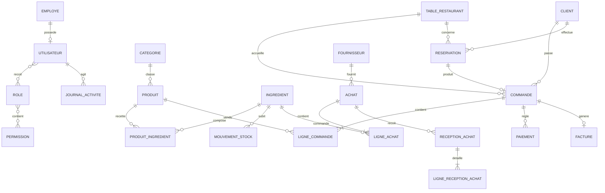
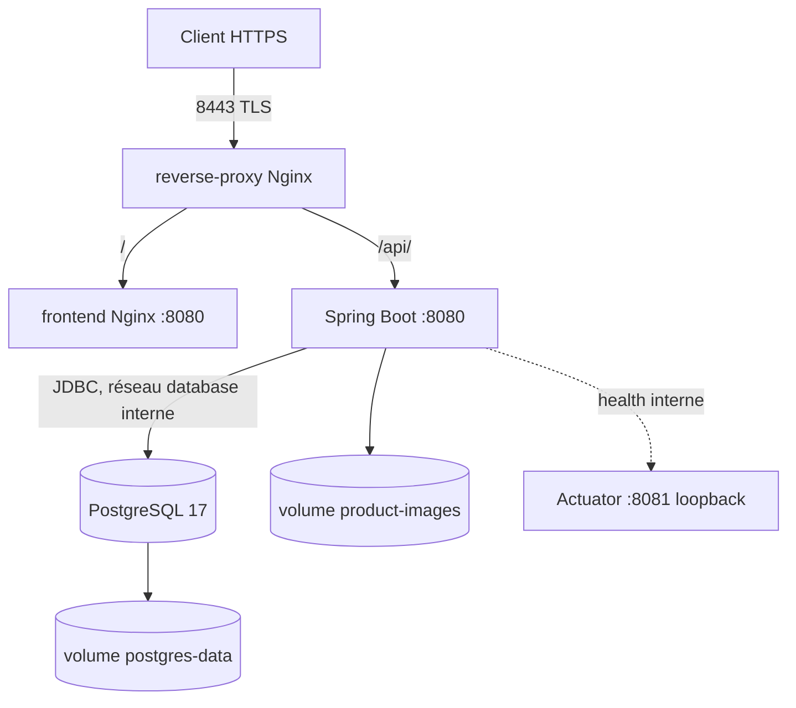
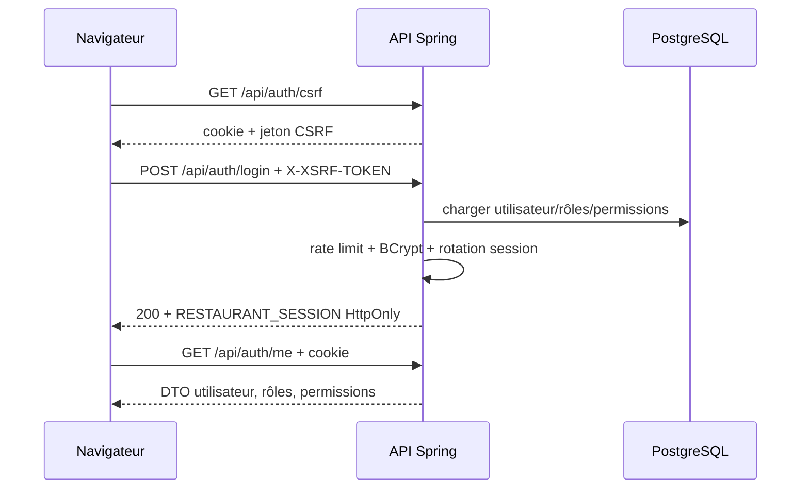
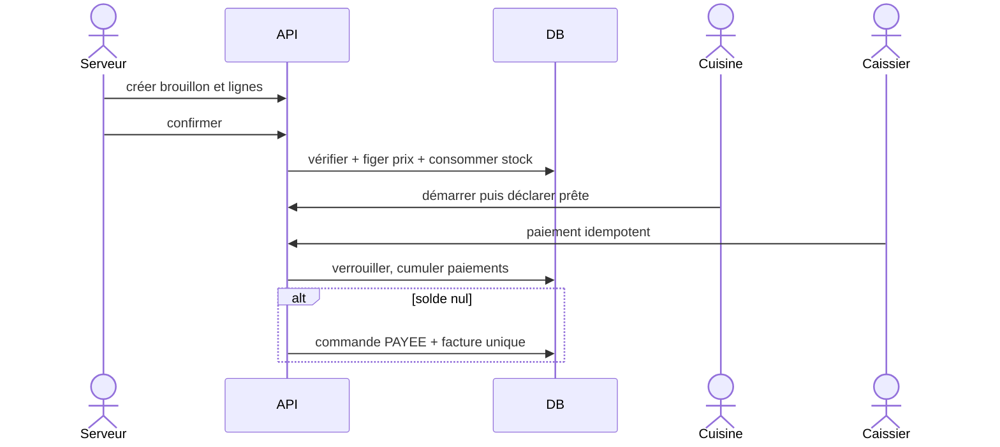

# Contexte technique vérifié du projet de gestion de restaurant

> **Finalité de ce document.** Ce fichier constitue une base factuelle pour la rédaction ultérieure d'un rapport de stage. Il ne constitue pas le rapport universitaire final. Les faits ci-dessous ont été vérifiés dans le code, la configuration, les migrations, les tests ou la documentation du dépôt au 29 août 2026. Les déductions sont explicitement signalées.

## 1. Résumé général du projet

### Identification et objectif

- **Nom technique :** `restaurant-backend` pour le backend et `restaurant-frontend` pour le frontend. Le dépôt ne fournit pas de nom commercial distinct.
- **Type :** application web interne de gestion intégrée d'un restaurant.
- **Domaine métier :** restauration, service en salle, cuisine, caisse, réservations, catalogue, stock, approvisionnement et administration.
- **Objectif observé :** centraliser les opérations d'un restaurant dans une interface web sécurisée, avec une API REST comme autorité métier.
- **Utilisateurs :** administrateur, gérant, serveur, caissier, personnel de cuisine et responsable de stock.
- **Résultat obtenu :** une application full-stack React/Spring Boot, persistée dans PostgreSQL, migrée par Flyway et déployable par Docker Compose derrière un reverse proxy Nginx HTTPS.

**Preuves principales :** `README.md`, `backend/pom.xml`, `frontend/package.json`, `frontend/src/routes/routeConfig.ts`, `backend/src/main/resources/db/migration/`, `compose.yaml`.

### Fonctionnalités majeures constatées

- authentification/déconnexion par session et récupération de l'utilisateur courant ;
- administration des comptes, rôles et états des utilisateurs ;
- gestion des employés, clients, tables, catégories et produits, y compris images de produits ;
- création et cycle de vie des commandes, lignes, tables et clients associés ;
- file de préparation en cuisine ;
- encaissements fractionnés, historique, facture et export PDF ;
- réservations et création de commande après arrivée ;
- ingrédients, recettes, mouvements et alertes de stock ;
- fournisseurs, achats, réceptions partielles et idempotentes ;
- tableaux de bord opérationnel et financier ;
- consultation paginée du journal d'activité.

### Architecture générale constatée



## 2. Problématique et solution

### Faits observés dans le projet

Le projet réunit dans un même système les données de personnel et de clientèle, le catalogue, les tables, les commandes, la préparation, les paiements, les réservations, les stocks, les fournisseurs, les achats et le pilotage. Il impose des transitions d'état, calcule les montants côté serveur, conserve les prix historiques, protège les opérations uniques par idempotence et journalise les actions sensibles.

**Preuves :** services sous `backend/src/main/java/com/restaurant/management/service/`, migrations `V1` à `V12`, documentation métier sous `docs/`.

### Interprétations possibles pour le rapport

Une gestion manuelle ou fragmentée peut provoquer des ressaisies, des incohérences entre salle/cuisine/caisse, des conflits de réservation, une traçabilité insuffisante, des erreurs de total et des écarts de stock. Le projet peut être présenté comme une réponse centralisée qui fiabilise les opérations, répartit les accès selon les responsabilités et rend l'activité consultable. Cette formulation est une **interprétation raisonnable**, non une déclaration fournie par un commanditaire dans le dépôt.

## 3. Besoins fonctionnels réellement couverts

| Domaine | Objectif et opérations | Acteurs autorisés selon les données initiales | Backend/API | Frontend | Entités et règles importantes |
|---|---|---|---|---|---|
| Authentification | CSRF, connexion, utilisateur courant, déconnexion | Tous comptes actifs | `AuthenticationController`, `/api/auth/*` | `LoginPage`, `AuthContext`, `authApi` | BCrypt, erreur uniforme, session renouvelée/révoquée |
| Utilisateurs | Créer, modifier, attribuer rôles, activer/désactiver, réinitialiser mot de passe, lister | Administrateur ; gérant selon permissions initiales, sauf attribution exigeant aussi `ROLE_GERER` | `/api/admin/utilisateurs` | `UtilisateursPage` | un compte par employé ; protection du dernier administrateur |
| Employés | CRUD sans suppression physique | Admin, gérant ; lecture accordée aux autres rôles | `/api/employes` | référentiel Employés | désactivation logique, matricule unique |
| Clients | Créer, modifier, activer/désactiver, consulter | Admin, gérant, serveur ; caissier pour gestion client | `/api/clients` | référentiel Clients | DTO, recherche paginée |
| Tables | Créer, modifier, statut, consulter | Admin/gérant ; serveur en lecture et gestion selon seed | `/api/tables` | référentiel Tables | capacité, état opérationnel, conflits de disponibilité |
| Catégories | Créer, modifier, désactiver, consulter | Admin/gérant et responsable stock en gestion ; autres rôles concernés en lecture | `/api/categories` | référentiel Catégories | nom normalisé unique ; catégorie active requise |
| Produits | Catalogue, prix, disponibilité, activation, image | Admin/gérant/responsable stock en gestion ; salle/caisse/cuisine en lecture | `/api/produits` | référentiel Produits | prix serveur, image PNG/JPEG/WebP, 5 Mo par défaut |
| Commandes | Brouillon, association table/client, lignes, confirmation, annulation, consultation | Admin, gérant, serveur ; caissier/cuisine en lecture | `/api/commandes` | `CommandesPage` | serveur limité à ses commandes ; prix copié ; total serveur ; stock consommé à confirmation |
| Cuisine | Voir file, démarrer, déclarer prête | Admin, gérant, cuisine | `/api/cuisine/commandes` | `CuisinePage` | projection sans données financières/personnelles ; transitions contrôlées |
| Caisse | Commandes à payer, paiements, historiques, facture JSON/PDF | Admin, gérant, caissier | `/api/caisse` | `CaissePage` | paiement seulement à `PRETE`, fractionnement, pas de surpaiement, facture après solde complet |
| Réservations | Créer, lister, confirmer, arrivée, terminer, annuler, absence, créer commande | Admin, gérant, serveur | `/api/reservations` | `ReservationsPage` | durée serveur de 2 h, conflits empêchés, commande unique après arrivée |
| Stock | Ingrédients, recettes, mouvements, historique | Admin, gérant, responsable stock ; cuisine en lecture | `/api/stock` | `StockPage`, `StockDashboardPage` | quantité à 3 décimales, mouvement immuable, idempotence, stock négatif exceptionnel admin |
| Fournisseurs/achats | Fournisseurs, brouillon d'achat, lignes, commande, réceptions, annulation | Admin, gérant, responsable stock | `/api/achats` | `FournisseursPage`, `AchatsPage` | réceptions partielles idempotentes, entrée de stock atomique |
| Pilotage | Indicateurs opérationnels, financiers et journal | opérations : tous rôles ; finances : admin/gérant ; journal : admin/gérant | `/api/tableau-de-bord` | `RoleDashboardPage`, `ReportsPage`, `JournalPage` | période max. 366 jours ; agrégations SQL ; journal en lecture seule |

Les affectations exactes proviennent des migrations `V2__seed_initial_roles_and_permissions.sql` à `V10__create_dashboard_permissions_and_indexes.sql`. Le frontend masque les routes, mais le backend reste l'autorité avec `@PreAuthorize` dans les services.

## 4. Besoins non fonctionnels

| Besoin | Réponse réellement présente | Preuves |
|---|---|---|
| Sécurité | refus par défaut, sessions, BCrypt, CSRF, CORS explicite, headers, permissions et contrôles de propriété | `SecurityConfig.java`, package `security`, `application-prod.yml` |
| Maintenabilité | architecture en couches, DTO séparés, mappers, migrations, documentation par domaine | packages backend, `docs/architecture.md` |
| Fiabilité | transactions, verrouillages optimistes/pessimistes, contraintes SQL et idempotence | services, entités `@Version`, migrations |
| Validation | Jakarta Bean Validation, refus des propriétés JSON inconnues, invariants métier dans les services | DTO, contrôleurs, `application.yml` |
| Gestion des erreurs | traduction centralisée, messages publics, absence de stack trace HTTP | `GlobalExceptionHandler.java`, handlers sécurité |
| Performance | pagination, tris en liste blanche, indexes SQL, agrégations SQL, pool Hikari prod | repositories, migrations `V10`/`V11`, `application-prod.yml` |
| Traçabilité | journal persistant avec acteur, action, résultat, ressource, date et corrélation | `JournalActivite`, services de journalisation |
| Ergonomie | navigation par rôle, états de chargement/erreur/vide, dialogues de confirmation, interface responsive dans CSS | frontend `layouts`, `components`, `features`, `styles.css` |
| Portabilité | images Docker multi-stage, Compose, variables d'environnement | Dockerfiles, `compose.yaml`, `.env.example` |
| Disponibilité | restart policies et healthchecks ; pas de haute disponibilité multi-nœud | `compose.yaml` |
| Scalabilité | backend stateless **non garanti** car sessions HTTP en mémoire ; pool et pagination présents, mais aucun cluster/session partagée | configuration session et Compose |
| Sauvegarde | volume PostgreSQL persistant ; aucune tâche automatique de sauvegarde/restauration trouvée | `compose.yaml`, `docs/docker-deployment.md` |
| Observabilité | logs bornés Docker et endpoint health uniquement ; pas de métriques/traces centralisées trouvées | Compose, Actuator config |

## 5. Acteurs, rôles et permissions

Les six rôles exacts sont déclarés dans `NomRole.java` et initialisés par Flyway.

| Acteur | Fonctionnalités accessibles (synthèse des seeds) | Restrictions principales |
|---|---|---|
| ADMINISTRATEUR | toutes les permissions initiales ; administration, opérations, finances, journal, stock négatif exceptionnel | authentification requise ; invariants métier ; seul rôle recevant `STOCK_NEGATIF_AUTORISER` |
| GERANT | utilisateurs/employés, référentiels, commandes, cuisine, caisse, réservations, stock, achats, tableaux de bord, finances, journal | n'a pas initialement `ROLE_GERER` ni `STOCK_NEGATIF_AUTORISER` ; certains changements de rôles exigent `ROLE_GERER` |
| SERVEUR | employés en lecture, clients, tables, catégories/produits en lecture, commandes, réservations, tableau de bord opérationnel | commandes limitées à celles dont il est créateur sauf rôle de supervision ; pas de finances/caisse/cuisine/stock |
| CAISSIER | employés en lecture, clients, catégories/produits et commandes en lecture, caisse, tableau de bord opérationnel | pas de gestion des commandes ni accès financier global |
| CUISINE | employés, catégories/produits/commandes et stock en lecture, flux cuisine, tableau de bord opérationnel | projection cuisine sans données financières ou personnelles ; pas de caisse |
| RESPONSABLE_STOCK | employés en lecture, catégories/produits, stock, fournisseurs/achats, tableau de bord opérationnel | pas de commandes, caisse, réservations ni finances |

Les 27 permissions exactes sont dans `NomPermission.java`. Attention : l'administrateur reçoit toutes les permissions existant lors de `V2` par `CROSS JOIN`, puis les migrations suivantes l'ajoutent explicitement aux nouveaux domaines.

## 6. Cas d'utilisation

### Cas principaux par acteur

- **Tous :** obtenir le jeton CSRF, se connecter, consulter leur identité, se déconnecter.
- **Administrateur :** administrer utilisateurs/employés et l'ensemble des opérations ; consulter audits et finances.
- **Gérant :** superviser référentiels, commandes, cuisine, caisse, réservations, stocks, achats et tableaux de bord.
- **Serveur :** gérer clients/tables, créer et faire évoluer ses commandes, gérer les réservations.
- **Cuisine :** consulter les commandes confirmées, démarrer la préparation et déclarer une commande prête.
- **Caissier :** consulter les commandes prêtes, enregistrer des paiements et éditer la facture.
- **Responsable stock :** maintenir produits/recettes/ingrédients, enregistrer mouvements, fournisseurs, achats et réceptions.



## 7. Architecture générale détaillée

Le navigateur charge une SPA React servie par un conteneur Nginx. Le reverse proxy frontal termine TLS, redirige HTTP vers HTTPS, sert le frontend et transfère `/api/` vers Spring Boot. Le frontend utilise `fetch` avec `credentials: 'include'`; le cookie de session HttpOnly est géré par le navigateur, tandis que le jeton CSRF est conservé en mémoire et envoyé dans `X-XSRF-TOKEN`. Spring Security authentifie, les contrôleurs valident les contrats DTO, les services appliquent autorisations et règles transactionnelles, puis les repositories accèdent à PostgreSQL par JPA/Hibernate. Flyway valide et fait évoluer le schéma.

**Reverse proxy :** présent et configuré dans `docker/reverse-proxy/nginx.conf`.

## 8. Analyse du backend

### Technologies et organisation

- Java 21 ; Spring Boot 3.5.16 ; Maven Wrapper 3.9.9 documenté ; API Spring MVC.
- Dépendances : Web, Security, Data JPA, Validation, Actuator, PostgreSQL, Flyway PostgreSQL, springdoc 2.8.17, PDFBox 3.0.8.
- Tests : Spring Boot Test, Spring Security Test, H2, JUnit/Mockito transitifs, Testcontainers PostgreSQL.
- Contrôle qualité : Maven Enforcer exige Java 21+ ; OWASP Dependency Check 12.2.2 au `verify`, seuil CVSS 7.

### Packages

| Package | Quantité observée | Rôle et classes représentatives |
|---|---:|---|
| `controller` | 15 | transport HTTP : `AuthenticationController`, `CommandeController`, `StockController` |
| `dto` | 68 | requêtes/réponses dédiées, pagination, tableaux de bord |
| `entity` | 25 | modèle JPA, relations et versions |
| `enums` | 13 | rôles, permissions, statuts et unités |
| `exception` | 7 | erreurs d'authentification, conflit, ressource, image, tri, rate limit |
| `mapper` | 8 | conversion entité/DTO |
| `repository` | 23 | interfaces Spring Data et requêtes d'agrégation/verrouillage |
| `security` | 8 | principal, chargement, sessions, handlers REST, limitation des connexions |
| `service` | 23 | règles métier et transactions |
| `validation` | 1 | validation de mot de passe (`StrongPassword`) |
| `config` | 2 | sécurité et propriétés/configuration technique |

### Arbre simplifié

```text
backend/
├── pom.xml
├── Dockerfile
└── src/
    ├── main/
    │   ├── java/com/restaurant/management/
    │   │   ├── config/ controller/ dto/ entity/ enums/
    │   │   ├── exception/ mapper/ repository/ security/
    │   │   ├── service/ validation/
    │   │   └── RestaurantManagementApplication.java
    │   └── resources/
    │       ├── application.yml
    │       ├── application-dev.yml
    │       ├── application-prod.yml
    │       └── db/migration/V1...V12.sql
    └── test/java/com/restaurant/management/
```

## 9. Analyse du frontend

### Technologies et conception

- React 19.2.8 et React DOM 19.2.8 ; TypeScript 7.0.2 en configuration stricte ; Vite 8.2.0.
- Aucun routeur externe : routeur léger interne (`Router.tsx`) fondé sur l'History API.
- Aucun gestionnaire d'état externe : contexte React pour l'authentification et état local par fonctionnalité.
- Aucun Axios : client `fetch` centralisé dans `api/client.ts`.
- Vitest 4.1.10, Testing Library Jest DOM et happy-dom pour les tests.
- Oxlint 1.77+ pour le lint.

### Organisation

```text
frontend/src/
├── api/                 # client HTTP et authentification
├── auth/                # contexte, RequireAuth, RequirePermission
├── components/          # confirmation et états de contenu
├── features/
│   ├── caisse/ cuisine/ dashboard/ referentiels/
│   ├── service/ stock/ utilisateurs/
├── layouts/             # navigation protégée
├── pages/               # connexion, accueil, 401/403/404
├── routes/              # routeur et matrice des routes
├── test/                # environnement DOM
├── types/ utils/
├── main.tsx
└── styles.css
```

### Authentification, autorisations et erreurs

`AuthContext` restaure la session avec `/api/auth/me`. Les requêtes incluent les credentials. `RequireAuth`, `RequirePermission`, `PermissionGate` et `routeConfig.ts` protègent/masquent l'interface. Ces contrôles sont ergonomiques ; ils ne remplacent pas `@PreAuthorize`. Le client gère notamment `401`, `403`, erreurs de validation, conflits et erreurs réseau. Les formulaires sont contrôlés côté React et le backend valide à nouveau.

## 10. Base de données et modèle de données

### Socle

PostgreSQL est la base cible. JPA/Hibernate mappe les entités ; `ddl-auto: validate` empêche la création implicite en production. Flyway contient 12 migrations de `V1` à `V12`. Aucun compte utilisateur n'est préconfiguré ; les rôles et permissions sont initialisés. Les identifiants sont des `BIGINT` générés. Les instants sont des `TIMESTAMPTZ`. Les montants utilisent `NUMERIC`/`BigDecimal`.

### Entités/tables

| Entité | Rôle | Relations principales |
|---|---|---|
| Employe | membre du personnel | 0..1 Utilisateur |
| Utilisateur | compte authentifiable | 1 Employe, N Roles, journaux, créations/encaissements |
| Role | regroupement d'autorisations | N Utilisateurs, N Permissions |
| Permission | autorisation atomique | N Roles |
| JournalActivite | audit append-only | acteur Utilisateur nullable |
| Client | fiche client | commandes et réservations |
| TableRestaurant | table/capacité/état | commandes et réservations |
| Categorie | classification | N Produits |
| Produit | article vendu | 1 catégorie, N recettes, N lignes de commande |
| Commande | agrégat de vente | table, client optionnel, créateur, réservation optionnelle, lignes, paiements, facture |
| LigneCommande | produit, quantité, prix historique | 1 Commande, 1 Produit |
| NotificationInterne | notification de commande prête | 1 Commande |
| Paiement | encaissement idempotent | 1 Commande, 1 encaisseur |
| Facture | instantané unique de commande payée | 1 Commande unique |
| Reservation | créneau d'une table pour un client | table, client, créateur, commande 0..1 |
| Ingredient | article de stock | recettes, mouvements, lignes d'achat |
| ProduitIngredient | recette et quantité | 1 Produit, 1 Ingredient |
| MouvementStock | variation immuable | ingrédient, commande/réception/acteur optionnels |
| Fournisseur | partenaire d'approvisionnement | N Achats |
| Achat | commande fournisseur | fournisseur, créateur, lignes, réceptions |
| LigneAchat | ingrédient commandé/prix/quantités | achat, ingrédient |
| ReceptionAchat | réception idempotente | achat, réceptionnaire, lignes |
| LigneReceptionAchat | quantité effectivement reçue | réception, ligne d'achat |

### Attributs, contraintes et statuts importants

- Entités mutables : `id`, dates de création/modification et fréquemment `version`; référentiels avec `actif`.
- Utilisateur : e-mail unique insensible à la casse, hash, employé unique.
- Commande : numéro unique, total `NUMERIC(12,2)`, états `BROUILLON`, `CONFIRMEE`, `EN_PREPARATION`, `PRETE`, `PAYEE`, `ANNULEE`.
- Paiement : clé UUID unique, modes `ESPECES`, `CARTE`, `CHEQUE`, `TITRE_RESTAURANT`, état `VALIDE`.
- Réservation : numéro, début/fin, nombre de personnes, états `EN_ATTENTE`, `CONFIRMEE`, `ARRIVEE`, `TERMINEE`, `ANNULEE`, `ABSENTE`.
- Stock : unités `GRAMME`, `KILOGRAMME`, `LITRE`, `MILLILITRE`, `UNITE`; mouvements `ENTREE`, `SORTIE`, `AJUSTEMENT`, `PERTE`, `RETOUR`.
- Achat : `BROUILLON`, `COMMANDE`, `PARTIELLEMENT_RECU`, `RECU`, `ANNULE`; lignes en `NUMERIC(14,3)` et prix en `NUMERIC(14,2)`.
- Indexes : recherche par noms/e-mails, statuts/dates, FKs, stock faible, tableaux de bord et historique des mouvements.



## 11. Sécurité réellement implémentée

| Protection | Rôle | Emplacement/preuve |
|---|---|---|
| Spring Security, refus par défaut | toute route non publique exige une identité | `SecurityConfig.securityFilterChain` |
| Sessions serveur | évite un jeton durable côté navigateur | `SessionAuthenticationService`, `application.yml` |
| Rotation de session | limite la fixation de session | `ChangeSessionIdAuthenticationStrategy` |
| Révocation dynamique | invalide une session si compte/employé/rôle/permission devient inactif ou change | `SessionSecurityValidationFilter` |
| Cookie | `RESTAURANT_SESSION`, HttpOnly, Secure prod, SameSite Strict, 15 min en Compose/prod | YAML et Compose |
| BCrypt coût 12 | hash non réversible des mots de passe | `SecurityConfig.passwordEncoder` |
| CSRF double soumission | cookie `XSRF-TOKEN`, header `X-XSRF-TOKEN` | `CookieCsrfTokenRepository`, client frontend |
| CORS explicite | credentials uniquement pour origines configurées, joker refusé | `SecurityConfig.corsConfigurationSource` |
| Permissions services | contrôle d'accès métier côté serveur | `@EnableMethodSecurity`, `@PreAuthorize` dans services |
| IDOR commandes | serveur limité à son propre créateur, admin/gérant supervisent | `CommandeService` |
| Rate limit connexion applicatif | 5 échecs/15 min par IP + e-mail normalisé | `LoginAttemptService` |
| Rate limit proxy | 5 connexions/min et 20 appels API/s par IP avec bursts | `docker/reverse-proxy/nginx.conf` |
| Anti-énumération | même erreur publique pour compte absent/inactif/mot de passe faux | `SessionAuthenticationService` |
| Headers | CSP, HSTS, anti-frame, nosniff Spring/Nginx, referrer, permissions policy | `SecurityConfig`, Nginx |
| HTTPS | terminaison TLS, TLS 1.2/1.3, redirection 308 | Nginx |
| Swagger/Actuator | Swagger réservé admin hors prod puis désactivé en prod ; Actuator health seul et lié à 127.0.0.1:8081 en prod | SecurityConfig et YAML prod |
| Secrets | variables d'environnement ; mots de passe obligatoires dans Compose | `.env.example`, Compose |
| Erreurs sûres | 401/403 JSON et erreurs sans stack trace | handlers REST, `GlobalExceptionHandler` |
| Images | taille, dimensions, MIME/signature, nom serveur | `ProduitImageStorageService` |

Le certificat et la clé sous `docker/tls/` présents dans l'arbre local ne doivent pas être présentés comme des certificats de production. Leur statut Git/sensibilité doit être contrôlé avant partage. Aucun JWT n'est utilisé.

## 12. Inventaire de l'API REST

Autorisation ci-dessous = permission exigée par le service. Tous les endpoints, sauf santé, CSRF et login, exigent aussi une session.

| Méthode | Endpoint | Description | Autorisation |
|---|---|---|---|
| GET | `/api/health` | santé publique minimale | public |
| GET | `/api/auth/csrf` | amorcer CSRF | public |
| POST | `/api/auth/login` | connexion | public + CSRF selon flux |
| GET | `/api/auth/me` | identité courante | authentifié |
| POST | `/api/auth/logout` | déconnexion | authentifié + CSRF |
| POST/PUT/PATCH/GET | `/api/admin/utilisateurs`, `/{id}`, `/{id}/roles`, `/{id}/statut`, `/{id}/mot-de-passe/reinitialisation` | administration des comptes | `UTILISATEUR_*`, rôle : aussi `ROLE_GERER` |
| POST/PUT/PATCH/GET | `/api/employes[/{id}]` | référentiel employés | `EMPLOYE_GERER/CONSULTER` |
| POST/PUT/PATCH/GET | `/api/clients[/{id}]` | référentiel clients | `CLIENT_GERER/CONSULTER` |
| POST/PUT/PATCH/GET | `/api/tables[/{id}]` | référentiel tables | `TABLE_GERER/CONSULTER` |
| POST/PUT/PATCH/GET | `/api/categories[/{id}]` | catégories | `CATEGORIE_GERER/CONSULTER` |
| POST/PUT/PATCH/GET | `/api/produits[/{id}]` | produits | `PRODUIT_GERER/CONSULTER` |
| PUT/GET/DELETE | `/api/produits/{id}/image` | image produit | gérer/consulter produit |
| POST | `/api/commandes` | créer brouillon | `COMMANDE_GERER` |
| PUT | `/api/commandes/{id}/association` | table/client | `COMMANDE_GERER` + périmètre |
| POST/PUT/DELETE | `/api/commandes/{id}/lignes[/{ligneId}]` | lignes | `COMMANDE_GERER` + périmètre |
| POST | `/api/commandes/{id}/confirmation` | confirmer | `COMMANDE_GERER` + périmètre |
| POST | `/api/commandes/{id}/annulation` | annuler | `COMMANDE_GERER` + périmètre |
| GET | `/api/commandes[/{id}]` | consulter/rechercher | `COMMANDE_CONSULTER` + périmètre |
| GET | `/api/cuisine/commandes` | file cuisine | `CUISINE_COMMANDES_GERER` |
| POST | `/api/cuisine/commandes/{numero}/demarrage` | démarrer | idem |
| POST | `/api/cuisine/commandes/{numero}/prete` | déclarer prête | idem |
| GET | `/api/caisse/commandes-a-payer` | commandes prêtes | `CAISSE_PAIEMENTS_GERER` |
| GET | `/api/caisse/paiements`, `/factures` | historiques | idem |
| POST/GET | `/api/caisse/commandes/{numero}/paiements` | enregistrer/lister paiements | idem ; POST avec `Idempotency-Key` |
| GET | `/api/caisse/commandes/{numero}/facture[.pdf]` | facture JSON/PDF | idem |
| POST/GET | `/api/reservations` | créer/lister | `RESERVATION_GERER` |
| POST | `/api/reservations/{id}/{confirmation|arrivee|terminaison|annulation|absence}` | transition | idem |
| POST | `/api/reservations/{id}/commande` | créer commande | `RESERVATION_GERER` + `COMMANDE_GERER` |
| POST/GET/PUT | `/api/stock/ingredients[/{id}]` | ingrédients | `STOCK_GERER/CONSULTER` |
| PUT/GET/DELETE | `/api/stock/produits/{produitId}/recette[/{ingredientId}]` | recette | `STOCK_GERER/CONSULTER` |
| POST/GET | `/api/stock/mouvements` | mouvement/historique | `STOCK_GERER/CONSULTER`; POST idempotent |
| POST/PUT/PATCH/GET | `/api/achats/fournisseurs[/{id}][/statut]` | fournisseurs | `ACHAT_GERER/CONSULTER` |
| POST/GET | `/api/achats[/{id}]` | achats | `ACHAT_GERER/CONSULTER` |
| POST | `/api/achats/{id}/lignes`, `/commande`, `/annulation` | cycle achat | `ACHAT_GERER` |
| POST/GET | `/api/achats/{id}/receptions` | réception | gérer/consulter ; POST idempotent |
| GET | `/api/tableau-de-bord/operations` | KPI opérationnels | `TABLEAU_BORD_CONSULTER` |
| GET | `/api/tableau-de-bord/finances` | KPI financiers | rôle admin/gérant + permission financière |
| GET | `/api/tableau-de-bord/journal`, `/journal/utilisateurs` | audit | `JOURNAL_ACTIVITE_CONSULTER` |

## 13. Validation et gestion des erreurs

Les contrôleurs utilisent `@Valid`, `@Validated`, `@Positive`, `@Size`, `@Min` et `@Max`. Les DTO portent les contraintes de contenu, dont une contrainte de mot de passe fort. Jackson rejette les champs inconnus, réduisant le mass assignment. Les services vérifient les invariants, statuts, propriété, activité des références, totaux et répétitions.

`GlobalExceptionHandler` traduit notamment validation, ressource absente, conflit métier/concurrence, tri invalide, image invalide et exceptions inattendues en réponses sûres. La configuration désactive message interne, exception, binding détaillé et stack trace. Les handlers de sécurité distinguent publiquement `401` et `403` sans exposer de secret. Le frontend transforme les erreurs API en messages d'interface ; il ne rend pas de trace serveur.

## 14. Tests et vérifications exécutées

### Backend

Familles trouvées : démarrage de contexte, contrôleurs/intégration, authentification/sécurité, repository PostgreSQL, service d'images, validation et gestion d'erreurs. Les intégrations PostgreSQL utilisent Testcontainers ; les autres tests utilisent notamment H2, MockMvc et Mockito.

**Commande exécutée :** `cd backend && ./mvnw test`

**Résultat le 29/08/2026 :** `BUILD SUCCESS`; 107 tests détectés, 0 échec, 0 erreur, 88 ignorés. Les 19 non ignorés ont réussi. Les 88 tests Testcontainers ont été ignorés car aucun environnement Docker valide (`/var/run/docker.sock` absent) n'était disponible. Ce résultat ne valide donc pas les intégrations PostgreSQL dans cette exécution.

### Frontend

Onze fichiers de tests couvrent client HTTP, routage, dialogue, utilisateurs, référentiels, commandes/réservations, cuisine, caisse, stock et tableau de bord/audit.

- `cd frontend && npm test` : Vitest a démarré, mais aucune progression/résultat n'a été émis pendant environ une minute ; commande interrompue, statut **indéterminé**.
- `cd frontend && npm run build` : TypeScript/Vite ont démarré, mais sans progression/résultat pendant environ une minute ; commande interrompue, statut **indéterminé**.

Aucun fichier n'a été modifié pour forcer ces commandes à réussir.

## 15. Technologies utilisées

| Technologie | Version vérifiée | Utilisation |
|---|---:|---|
| Java | 21 | backend |
| Spring Boot | 3.5.16 | framework backend |
| Spring Security | gérée par Boot 3.5.16 | authentification/autorisation |
| Hibernate ORM | 6.6.53.Final observé lors des tests | implémentation JPA |
| PostgreSQL | image 17.11 Alpine 3.24 | base de production/Compose |
| Flyway | gérée par Boot | migrations V1–V12 |
| springdoc OpenAPI | 2.8.17 | documentation API hors prod |
| Apache PDFBox | 3.0.8 | factures PDF |
| Maven | wrapper, 3.9.9 documenté ; image 3.9.16 | build backend |
| React / React DOM | 19.2.8 | frontend |
| TypeScript | 7.0.2 | typage frontend |
| Vite | 8.2.0 | build/dev frontend |
| Vitest | 4.1.10 | tests frontend |
| happy-dom | 20.8.9 | DOM de test |
| Oxlint | ^1.77.0 | lint frontend |
| Node.js | image 24.19.0 | build Docker frontend |
| Nginx | 1.30.4 Alpine | frontend ; reverse proxy basé sur image distincte documentée par Dockerfile |
| Docker Compose | format Compose moderne | orchestration |
| Testcontainers | 1.21.4 observé | intégrations PostgreSQL |
| OWASP Dependency Check | 12.2.2 | audit Maven au `verify` |

## 16. Docker et déploiement

Le backend et le frontend sont construits par images multi-stage puis exécutés par utilisateurs non-root. Compose déploie PostgreSQL, backend, frontend et reverse proxy sur réseaux `edge` et `database`; le réseau base est interne. Les conteneurs applicatifs abandonnent toutes les capacités, activent `no-new-privileges`, utilisent un système de fichiers en lecture seule et des `tmpfs`. Des limites CPU, mémoire, PID, healthchecks, redémarrages et rotation de logs sont définis. Les images produits et données PostgreSQL sont persistées par volumes.

Nginx expose par défaut `127.0.0.1:8080/8443`, redirige HTTP, termine TLS, applique headers et limites, puis route frontend/API. Les secrets DB et chemins TLS sont obligatoires. Swagger est désactivé en production ; Actuator écoute localement sur 8081. Aucune automatisation de sauvegarde, restauration, CI/CD ou renouvellement de certificat n'est implémentée dans le dépôt.



## 17. Interfaces graphiques

| Route | Page | Public concerné | Contenu/opérations |
|---|---|---|---|
| `/connexion` | Connexion | non authentifié | e-mail, mot de passe, connexion |
| `/` | Accueil | authentifié | accueil et accès aux sections autorisées |
| `/tableau-de-bord` | Tableau de bord par rôle | permission KPI | synthèse adaptée au rôle |
| `/utilisateurs` | Utilisateurs | administration | liste, création, détail, rôles, statut, mot de passe |
| `/employes` | Employés | personnel autorisé | référentiel et formulaire |
| `/clients` | Clients | salle/gestion/caisse | référentiel et formulaire |
| `/tables` | Tables | salle/gestion | capacité et statut |
| `/categories` | Catégories | catalogue | référentiel |
| `/produits` | Produits | catalogue | produit, prix, disponibilité, image |
| `/commandes` | Commandes | salle/supervision | liste, brouillon, lignes, confirmation/annulation |
| `/cuisine` | Cuisine | cuisine/supervision | file et transitions de préparation |
| `/caisse` | Caisse | caisse/supervision | restant dû, paiements, factures |
| `/reservations` | Réservations | salle/supervision | planification et transitions |
| `/stock` | Stock | stock/cuisine lecture | ingrédients, recettes, mouvements |
| `/fournisseurs` | Fournisseurs | approvisionnement | liste et gestion |
| `/achats` | Achats | approvisionnement | cycle achat/réception |
| `/rapports` | Rapports | admin/gérant | indicateurs financiers et période |
| `/journal-activite` | Journal | admin/gérant | filtres et historique |
| `/403`, route inconnue | accès interdit/404 | tous | messages sûrs |

### Captures d'écran recommandées pour le rapport

1. **Connexion** — ouvrir `/connexion`; montrer le formulaire sans saisir de secret. *Figure : Interface sécurisée d'authentification.*
2. **Accueil/navigation** — se connecter avec un compte de démonstration non sensible ; montrer le menu adapté. *Figure : Espace d'accueil et navigation par autorisations.*
3. **Tableau de bord** — choisir une période ; montrer les indicateurs. *Figure : Synthèse opérationnelle du restaurant.*
4. **Utilisateurs** — afficher la liste et le panneau de détail, avec données fictives. *Figure : Administration des comptes et rôles.*
5. **Produits** — afficher catalogue, disponibilité et image. *Figure : Gestion du catalogue des produits.*
6. **Tables** — montrer capacités et états. *Figure : Référentiel opérationnel des tables.*
7. **Commande brouillon** — afficher table, client et lignes. *Figure : Constitution d'une commande en salle.*
8. **Cuisine** — montrer les files confirmée/en préparation/prête. *Figure : Suivi des préparations en cuisine.*
9. **Caisse** — sélectionner une commande prête et le restant dû. *Figure : Interface d'encaissement d'une commande.*
10. **Facture** — afficher une facture avec données fictives. *Figure : Facture générée après paiement complet.*
11. **Réservations** — montrer la liste et les statuts. *Figure : Planification et suivi des réservations.*
12. **Stock** — afficher niveaux/seuils. *Figure : Suivi des ingrédients et alertes de stock.*
13. **Mouvements de stock** — montrer l'historique filtré. *Figure : Traçabilité des variations de stock.*
14. **Achats** — montrer un achat et ses réceptions partielles. *Figure : Gestion des approvisionnements fournisseurs.*
15. **Rapports financiers** — montrer la période et les agrégats avec chiffres fictifs. *Figure : Tableau de bord financier réservé à la direction.*
16. **Journal d'activité** — montrer les filtres et actions, sans IP/donnée sensible. *Figure : Consultation de la piste d'audit applicative.*

Éviter console, URL technique mise en avant, logs, mots de passe, jetons, cookies, secrets et données personnelles réelles.

## 18. Diagrammes pertinents pour le rapport

- **Cas d'utilisation :** illustre la répartition des responsabilités ; base PlantUML fournie en section 6.
- **Architecture en couches :** navigateur → proxy → frontend/API → services → repositories → PostgreSQL ; Mermaid section 1.
- **Modèle de données :** montre les agrégats et relations ; Mermaid section 10.
- **Déploiement :** conteneurs, réseaux et volumes ; Mermaid section 16.
- **Séquence d'authentification :** CSRF, login BCrypt, rotation, session, `/me`.



- **Séquence commande à facture :** commande/lignes → confirmation et stock → cuisine → paiement(s) → facture.



## 19. Organisation représentative du dépôt

```text
restaurant-project/
├── AGENTS.md
├── README.md
├── .env.example
├── compose.yaml
├── backend/
│   ├── pom.xml, mvnw, Dockerfile
│   └── src/{main,test}/...
├── frontend/
│   ├── package.json, vite.config.ts, vitest.config.ts, Dockerfile
│   ├── docker/nginx.conf
│   └── src/...
├── docker/
│   └── reverse-proxy/{Dockerfile,nginx.conf,proxy_params}
├── docs/
│   ├── architecture.md, security-requirements.md
│   └── documents métier et déploiement
└── scripts/
    └── docker-smoke-test.sh
```

`node_modules`, `dist`, `target.nosync`, fichiers IDE et fichiers système sont volontairement omis.

## 20. Méthodologie de développement

### Faits vérifiables

- Branche courante : `feature/backend-initialization`, synchronisée au commit `0113a6a` avec la branche distante au moment de l'analyse.
- Deux commits seulement sont accessibles dans l'historique normal : `chore: initialisation du projet` et `first step`.
- Un stash intitulé `wip étape 2` existe.
- La documentation décrit des étapes numérotées jusqu'à 13 et un document par domaine.
- Des tests backend/frontend accompagnent les fonctionnalités.
- L'essentiel du projet complet est actuellement non validé dans l'arbre de travail ; l'historique Git ne prouve donc pas sa progression détaillée.

### Proposition de présentation pour le rapport

On peut présenter une progression incrémentale par socle, sécurité, référentiels, commandes, cuisine, caisse, réservations, stock, achats, pilotage, frontend et déploiement **en se fondant sur la documentation et les migrations**. Il ne faut pas affirmer l'usage de Scrum, de sprints, de revues client ou d'une équipe sans témoignage externe. Il est préférable de qualifier l'approche de développement incrémental documenté.

## 21. Difficultés techniques étayées par le dépôt

| Problème | Cause/indice | Solution implémentée | Résultat observable |
|---|---|---|---|
| Écritures concurrentes | commandes, stock, réservation, paiements et réceptions peuvent être traités simultanément | `@Version`, verrous pessimistes, contraintes uniques, transactions | conflits détectables, effets uniques protégés |
| Double paiement/réception/mouvement | répétition réseau possible | clés UUID idempotentes et signatures/contraintes | répétition sans double effet attendu |
| Cohérence salle-cuisine-caisse | états interdépendants | machine à états explicite de Commande | paiement limité à PRETE, facture après paiement complet |
| Conflits de réservation | créneaux concurrents | verrou table, intervalle semi-ouvert et vérification transactionnelle | réservation conflictuelle rejetée |
| Fiabilité des images | uploads non fiables | MIME/signature, taille/pixels, nom généré, stockage hors DB | formats et volume bornés |
| Sécurité de session après changement de droits | principal en session potentiellement obsolète | filtre de validation de session | révocation lors de changements critiques |
| Fichiers compilés sous Documents/iCloud | commentaire explicite dans `pom.xml` sur fichiers « dataless » | répertoire Maven `target.nosync` | artefacts hors synchronisation iCloud |

Il n'est pas possible d'attribuer ces difficultés à une expérience personnelle du stagiaire sans son témoignage.

## 22. Points forts à présenter au jury

- couverture fonctionnelle cohérente du flux complet, de la réservation à la facture et à l'approvisionnement ;
- autorisation fine par rôles/permissions et contrôle de propriété des commandes ;
- sécurité en profondeur (session, CSRF, CORS, headers, proxy, rate limits, secrets externes) ;
- calculs financiers côté serveur, instantanés de prix et facture atomique ;
- concurrence et idempotence prises en compte ;
- schéma versionné par Flyway avec contraintes/indexes ;
- architecture DTO/services/repositories claire ;
- journal d'activité et tableaux de bord ;
- tests par domaine, dont intégrations PostgreSQL Testcontainers ;
- déploiement Docker durci : non-root, lecture seule, capacités abandonnées, réseaux séparés.

## 23. Limites et perspectives

### Limites réellement observables

- aucun nom commercial ni contexte d'entreprise dans le code ;
- historique Git normal très réduit et projet achevé majoritairement non commité ;
- tests Testcontainers non exécutés dans cette analyse faute de Docker ; tests/build frontend sans conclusion ;
- aucune CI/CD trouvée ;
- aucune sauvegarde/restauration automatisée ;
- healthcheck seul, sans métriques, traces distribuées ni supervision centralisée ;
- déploiement mono-instance et sessions locales, sans mécanisme de cluster ;
- notifications internes persistées mais aucune API/écran complet de notifications identifié ;
- aucune application mobile ni temps réel WebSocket trouvé ;
- aucun mécanisme « mot de passe oublié » autonome ou e-mail transactionnel trouvé ; la réinitialisation est administrative.

### Perspectives possibles — non implémentées

- CI/CD avec tests, analyse de dépendances et publication d'images ;
- sauvegardes PostgreSQL automatisées et tests de restauration ;
- métriques Prometheus, tableaux Grafana, agrégation de logs et alertes ;
- stockage de sessions partagé/Redis et déploiement haute disponibilité ;
- notifications temps réel cuisine/salle et centre de notifications ;
- application mobile ou PWA ;
- prévisions de stock et statistiques avancées ;
- renouvellement automatisé des certificats et gestionnaire de secrets ;
- tests end-to-end navigateur et accessibilité automatisée.

## 24. Glossaire

- **API :** interface de programmation exposée ici en HTTP/JSON.
- **BCrypt :** algorithme adaptatif de hash de mot de passe.
- **CORS :** règles autorisant certaines origines web à appeler l'API.
- **CSP :** politique limitant les sources de contenus exécutables/affichables.
- **CSRF :** attaque forçant une requête avec la session d'un utilisateur ; contrée par jeton.
- **DTO :** objet contractuel d'entrée ou sortie, distinct des entités JPA.
- **Flyway :** outil de migration versionnée du schéma SQL.
- **HSTS :** header imposant l'usage ultérieur de HTTPS.
- **HTTP/HTTPS :** protocole web, chiffré par TLS dans le second cas.
- **Idempotence :** garantie qu'une répétition ne produit pas plusieurs effets métier.
- **JPA :** standard Java de persistance objet-relationnelle.
- **ORM :** correspondance entre objets Java et tables relationnelles.
- **REST :** style d'API orienté ressources et méthodes HTTP.
- **RBAC :** contrôle d'accès fondé sur rôles et permissions.
- **SGBD :** système de gestion de base de données ; PostgreSQL ici.
- **SPA :** application web monopage React.
- **SQL :** langage relationnel utilisé par les migrations/requêtes.
- **TLS :** chiffrement du transport HTTPS.
- **UML :** langage de modélisation pour cas, classes et séquences.

## 25. Liste de figures potentielles

- Figure 2.1 : Diagramme de cas d'utilisation par acteur.
- Figure 2.2 : Modèle conceptuel des données.
- Figure 2.3 : Séquence d'authentification par session.
- Figure 2.4 : Séquence de la commande à la facture.
- Figure 3.1 : Architecture générale de l'application.
- Figure 3.2 : Architecture en couches du backend.
- Figure 3.3 : Architecture de déploiement Docker.
- Figure 4.1 : Interface de connexion.
- Figure 4.2 : Tableau de bord opérationnel.
- Figure 4.3 : Administration des utilisateurs.
- Figure 4.4 : Catalogue des produits.
- Figure 4.5 : Constitution d'une commande.
- Figure 4.6 : Flux de préparation en cuisine.
- Figure 4.7 : Encaissement et facture.
- Figure 4.8 : Gestion des réservations.
- Figure 4.9 : Gestion des stocks.
- Figure 4.10 : Gestion des achats fournisseurs.
- Figure 4.11 : Rapports financiers.
- Figure 4.12 : Journal d'activité.

## 26. Liste de tableaux potentiels

- Tableau 2.1 : Besoins fonctionnels.
- Tableau 2.2 : Besoins non fonctionnels.
- Tableau 2.3 : Acteurs et restrictions.
- Tableau 2.4 : Rôles et permissions.
- Tableau 2.5 : Entités et relations.
- Tableau 3.1 : Technologies et versions.
- Tableau 3.2 : Packages du backend.
- Tableau 3.3 : Modules du frontend.
- Tableau 3.4 : Protections de sécurité.
- Tableau 3.5 : Endpoints REST par domaine.
- Tableau 3.6 : Services et conteneurs Docker.
- Tableau 4.1 : Pages et routes de l'interface.
- Tableau 4.2 : Familles de tests et résultats.
- Tableau 4.3 : Difficultés techniques et solutions.

## 27. Proposition de structure du rapport académique

### Pages préliminaires

Dédicace ; remerciements ; résumé ; abstract ; glossaire ; liste des figures ; liste des tableaux ; table des matières.

### Introduction générale

Contexte du stage, problématique, objectifs, démarche et organisation du document.

### Chapitre 1 — Organisme d'accueil et contexte du projet

1. Présentation de l'organisme (à fournir)
2. Organisation et activité (à fournir)
3. Contexte de la mission
4. Limites de la gestion traditionnelle (comme interprétation)
5. Objectifs et périmètre de l'application
6. Acteurs et environnement du projet

### Chapitre 2 — Analyse et conception

1. Recueil et classification des besoins
2. Besoins fonctionnels et non fonctionnels
3. Acteurs, rôles et permissions
4. Diagramme de cas d'utilisation
5. Règles métier et cycles d'état
6. Modèle de données/diagramme de classes
7. Séquences authentification et commande-paiement
8. Choix de sécurité et de concurrence

### Chapitre 3 — Étude technique

1. Architecture globale et séparation frontend/backend
2. Technologies backend
3. Architecture en couches et API REST
4. Technologies et organisation frontend
5. PostgreSQL, JPA et Flyway
6. Sécurité applicative
7. Docker, Nginx et configuration de production
8. Stratégie de tests et qualité

### Chapitre 4 — Réalisation et mise en œuvre

1. Authentification et administration
2. Référentiels du restaurant
3. Commandes et cuisine
4. Paiements et facturation
5. Réservations
6. Stocks, recettes et approvisionnements
7. Tableaux de bord et audit
8. Interfaces principales avec captures
9. Déploiement et vérification
10. Difficultés techniques, solutions et résultats

### Conclusion générale et perspectives

Bilan par rapport aux objectifs, apports du stage, limites observées et perspectives explicitement non implémentées.

### Références et annexes

Documentation officielle des technologies, extraits de contrats API, matrices de permissions, diagrammes complets, commandes de lancement/test et guide de déploiement.

## 28. Informations que le code ne peut pas fournir

- nom, statut juridique, secteur précis, adresse et historique de l'organisme d'accueil ;
- organigramme, effectifs, services et position du stagiaire ;
- nom complet du stagiaire, filière, établissement et année universitaire ;
- dates, durée, ville et modalités du stage ;
- noms/fonctions des encadrants pédagogique et professionnel ;
- demande initiale exacte, commanditaire, utilisateurs interviewés et cahier des charges validé ;
- situation antérieure réelle du restaurant et outils effectivement remplacés ;
- contraintes budgétaires, matérielles, légales ou de calendrier ;
- méthode de travail réellement suivie (Scrum, Kanban, individuel, réunions, outils) ;
- chronologie réelle et temps consacré à chaque phase ;
- contributions éventuelles d'autres personnes ;
- raisons personnelles des choix techniques, si elles ne sont pas dans la documentation ;
- difficultés personnellement rencontrées, apprentissages et arbitrages ;
- jeux de données réels, volume d'utilisation et retours utilisateurs ;
- environnement réel de production, hébergeur, domaine et statut effectif du déploiement ;
- résultats d'une soutenance, recette client ou mesure de satisfaction ;
- captures d'écran définitives et données fictives choisies pour la démonstration.

## 29. Niveau de confiance de l'analyse

### Très certain

Versions déclarées, structure du code, rôles et permissions initiaux, entités, migrations, endpoints, routes frontend, règles visibles dans les services, sécurité configurée et architecture Docker. Ces éléments disposent de preuves directes dans les fichiers cités.

### À vérifier

- résultat complet des 88 tests Testcontainers avec Docker/PostgreSQL disponible ;
- résultat des tests, du typecheck, du lint et du build frontend dans un environnement où les processus terminent normalement ;
- fonctionnement du smoke test Docker avec certificats et variables valides ;
- compatibilité du certificat TLS local avec l'environnement de démonstration ;
- exactitude ergonomique des captures à partir d'une instance alimentée en données fictives ;
- matrice finale en base si des rôles/permissions ont été modifiés après les seeds.

### Informations absentes

Toutes les informations institutionnelles, humaines et historiques listées en section 28, ainsi que toute preuve de mise en production réelle, de sauvegarde opérationnelle, de CI/CD ou d'observabilité externe.

## 30. Commandes pertinentes

```bash
# Backend local (variables PostgreSQL requises)
cd backend
./mvnw spring-boot:run -Dspring-boot.run.profiles=dev

# Tests backend
./mvnw test

# Build backend (l'étape verify déclenche aussi OWASP Dependency Check)
./mvnw clean package
./mvnw verify

# Frontend
cd frontend
npm ci
npm run dev
npm test
npm run typecheck
npm run lint
npm run build

# Déploiement Docker (variables et chemins TLS requis)
docker compose up --build -d
./scripts/docker-smoke-test.sh
docker compose down
```

## 31. Checklist de vérification manuelle et limites restantes

- [ ] Démarrer PostgreSQL et vérifier l'application des migrations V1–V12.
- [ ] Créer des comptes de démonstration pour chacun des six rôles.
- [ ] Vérifier `401`, `403` et accès autorisé sur chaque grand domaine.
- [ ] Tester le périmètre des commandes d'un serveur contre un autre serveur.
- [ ] Parcourir commande → cuisine → paiements fractionnés → facture PDF.
- [ ] Tester un conflit de réservation et la création de commande après arrivée.
- [ ] Tester consommation de stock, seuil faible, achat et réception répétée.
- [ ] Vérifier révocation de session après désactivation/changement de rôles.
- [ ] Exécuter les 107 tests backend avec Docker pour supprimer les 88 skips.
- [ ] Exécuter avec conclusion `npm test`, `npm run lint`, `npm run typecheck`, `npm run build`.
- [ ] Déployer Compose avec secrets/certificats de démonstration et exécuter le smoke test.
- [ ] Vérifier les headers HTTPS et l'absence de Swagger/Actuator public en production.
- [ ] Préparer des données fictives et réaliser les captures recommandées.
- [ ] Fournir les informations institutionnelles et personnelles absentes avant la rédaction du rapport final.

**Limite principale de cette analyse :** l'absence de Docker a empêché l'exécution des intégrations PostgreSQL ; les commandes frontend sont restées sans résultat observable et ont été interrompues. Aucun de ces points ne doit être présenté comme validé.
