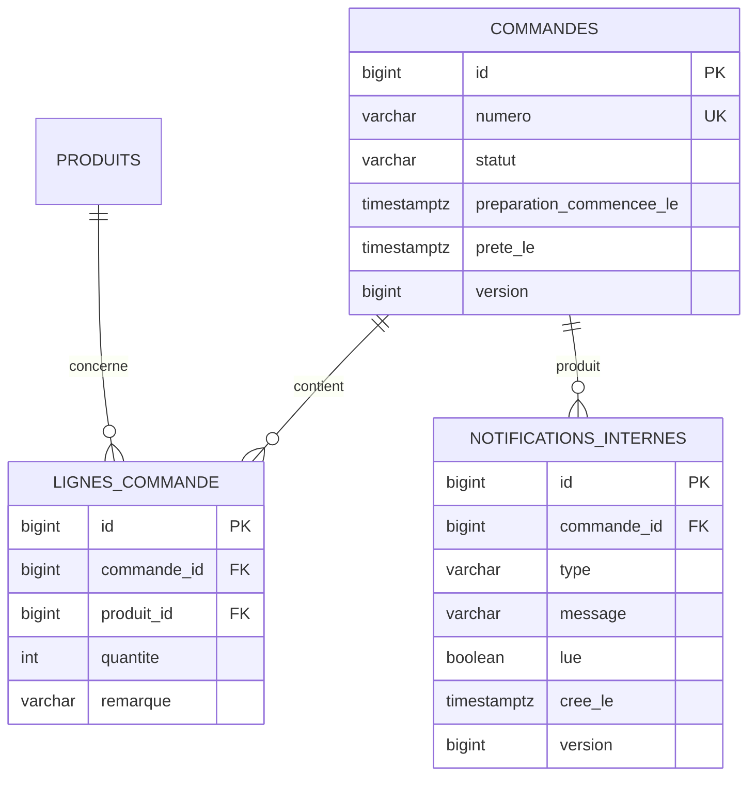

# Étape 7 — Flux de la cuisine

## API

- `GET /api/cuisine/commandes` retourne toutes les commandes `CONFIRMEE` et
  `EN_PREPARATION`, ainsi que les commandes encore `PRETE` devenues prêtes dans
  les deux dernières heures. Ce délai fixe constitue l’historique court de la
  cuisine. Les résultats sont ordonnés par heure de confirmation.
- `POST /api/cuisine/commandes/{numero}/demarrage` applique
  `CONFIRMEE -> EN_PREPARATION`.
- `POST /api/cuisine/commandes/{numero}/prete` applique
  `EN_PREPARATION -> PRETE`.

Toutes ces routes exigent l’autorité `CUISINE_COMMANDES_GERER` et les écritures
exigent un jeton CSRF. La permission est attribuée par migration aux rôles
`CUISINE`, `GERANT` et `ADMINISTRATEUR`.

## Données exposées

La projection cuisine contient uniquement :

- le numéro de commande ;
- le numéro de table ;
- le nom des produits, leur quantité et leur remarque éventuelle ;
- l’heure de confirmation ;
- l’état.

Elle ne contient aucun identifiant personnel, client, créateur, prix,
sous-total ou total.

## Cohérence

`Commande.version` assure le verrouillage optimiste des changements concurrents.
Chaque transition est validée dans l’entité, journalisée, puis validée en base.
Le passage à `PRETE` crée dans la même transaction une notification interne
unique de type `COMMANDE_PRETE`.

## Schéma ajouté

