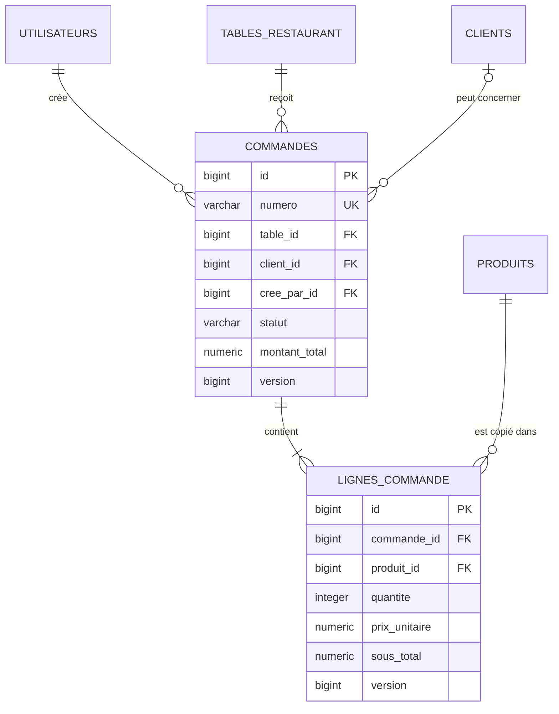

# Commandes — étape 6

## Modèle



## Transitions

```text
BROUILLON -> CONFIRMEE -> ANNULEE
    |
    +------------------> ANNULEE
```

Une commande confirmée ne peut plus changer de table, de client ou de lignes.

## Routes

- `POST /api/commandes` : créer un brouillon ;
- `PUT /api/commandes/{id}/association` : changer table/client du brouillon ;
- `POST /api/commandes/{id}/lignes` : ajouter un produit ;
- `PUT /api/commandes/{id}/lignes/{ligneId}` : changer une quantité ;
- `DELETE /api/commandes/{id}/lignes/{ligneId}` : retirer une ligne du brouillon ;
- `POST /api/commandes/{id}/confirmation` : confirmer ;
- `POST /api/commandes/{id}/annulation` : annuler ;
- `GET /api/commandes/{id}` et `GET /api/commandes` : consulter.

Toutes les écritures nécessitent CSRF et `COMMANDE_GERER`. Les lectures nécessitent
`COMMANDE_CONSULTER`.
