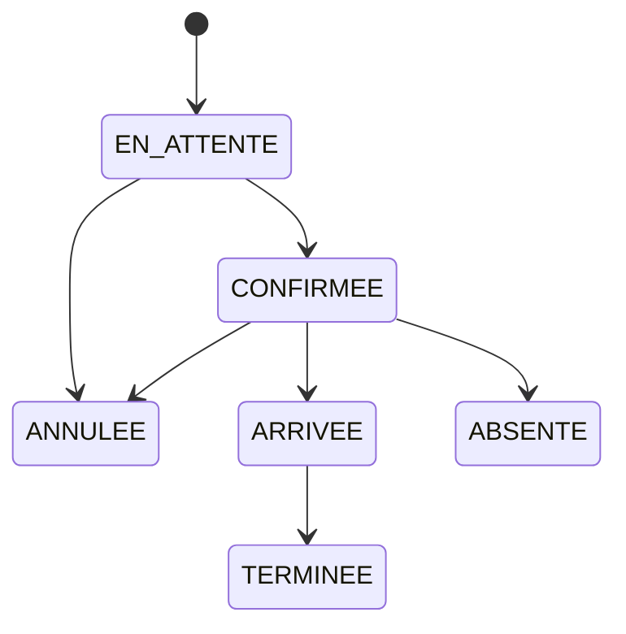
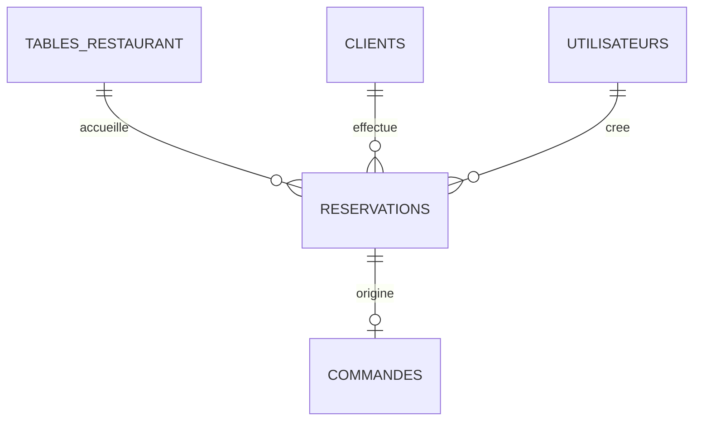

# Étape 9 — Réservations

## Durée et conflits

Une réservation dure exactement **2 heures**. Le client transmet uniquement
l'heure de début ; l'heure de fin est calculée par le serveur et protégée par
une contrainte SQL.

Les créneaux sont semi-ouverts : `[début, fin)`. Une réservation finissant à
20:00 ne bloque donc pas une autre réservation commençant à 20:00.

Les états qui occupent une table sont `EN_ATTENTE`, `CONFIRMEE` et `ARRIVEE`.
Les états `TERMINEE`, `ANNULEE` et `ABSENTE` libèrent immédiatement le créneau.

## Cycle d'état

Une transition non représentée est refusée avec un conflit HTTP `409`.

## Concurrence

La création commence par un verrou pessimiste sur la ligne
`tables_restaurant`. La vérification de chevauchement et l'insertion sont faites
dans cette même transaction. Deux demandes simultanées pour une même table sont
donc sérialisées. La réservation possède également un champ `@Version`.

## Commande associée

Une commande ne peut être créée qu'après le passage de la réservation à
`ARRIVEE`. Une contrainte unique garantit au maximum une commande par
réservation. La table et le client sont copiés depuis la réservation, jamais
acceptés depuis le corps de cette requête. La terminaison ou le paiement complet
libère la réservation si elle est encore à l'état `ARRIVEE`.

## API et autorisation

Toutes les routes exigent `RESERVATION_GERER`, attribuée à `ADMINISTRATEUR`,
`GERANT` et `SERVEUR`. La création de commande exige aussi `COMMANDE_GERER`.

- `POST /api/reservations`
- `GET /api/reservations?date=YYYY-MM-DD&statut=CONFIRMEE&page=0&taille=20`
- `POST /api/reservations/{id}/confirmation`
- `POST /api/reservations/{id}/arrivee`
- `POST /api/reservations/{id}/terminaison`
- `POST /api/reservations/{id}/annulation`
- `POST /api/reservations/{id}/absence`
- `POST /api/reservations/{id}/commande`

Les paramètres `date` et `statut` de la liste sont optionnels et cumulables.
La date sélectionne les réservations dont le début appartient à la journée du
restaurant, interprétée dans le fuseau configurable
`app.restaurant.time-zone` (`Africa/Casablanca` par défaut). Le filtrage est
réalisé en base avant la pagination.

## Schéma

