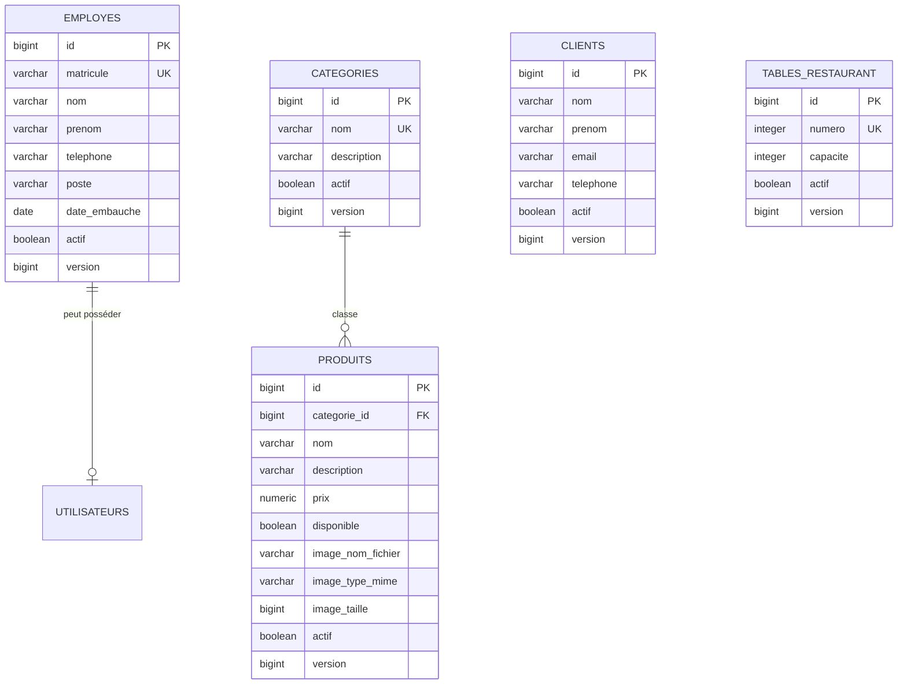

# Référentiels du restaurant — étape 5

## Schéma relationnel

Toutes les entités possèdent également `cree_le` et `modifie_le`.

## Routes

Chaque ressource utilise le même modèle :

- `POST /api/{ressource}` : création ;
- `PUT /api/{ressource}/{id}` : modification ;
- `PATCH /api/{ressource}/{id}/statut` : activation ou désactivation ;
- `GET /api/{ressource}/{id}` : consultation ;
- `GET /api/{ressource}` : recherche paginée.

Les ressources sont `employes`, `clients`, `tables`, `categories` et `produits`.
Les listes acceptent `recherche`, `actif`, `page`, `taille`, `tri` et `direction`.
Les produits acceptent en plus `categorieId` et `disponible`. Le champ `actif`
préserve l'historique administratif tandis que `disponible` permet de retirer
temporairement un produit de la prise de commande sans le désactiver.

Les images utilisent les routes dédiées suivantes :

- `PUT /api/produits/{id}/image` : ajout ou remplacement multipart (`fichier`) ;
- `GET /api/produits/{id}/image` : consultation de l'image ;
- `DELETE /api/produits/{id}/image` : retrait de l'image.

Seuls PNG, JPEG et WebP sont acceptés, après vérification de la signature réelle
du fichier et du type MIME. La taille maximale par défaut est de 5 Mo. Le serveur
génère le nom, stocke uniquement les métadonnées en base et empêche qu'un chemin
fourni par le client soit utilisé.

Les requêtes modifiant l'état nécessitent un jeton CSRF et la permission `*_GERER`.
Les lectures nécessitent la permission `*_CONSULTER`.
