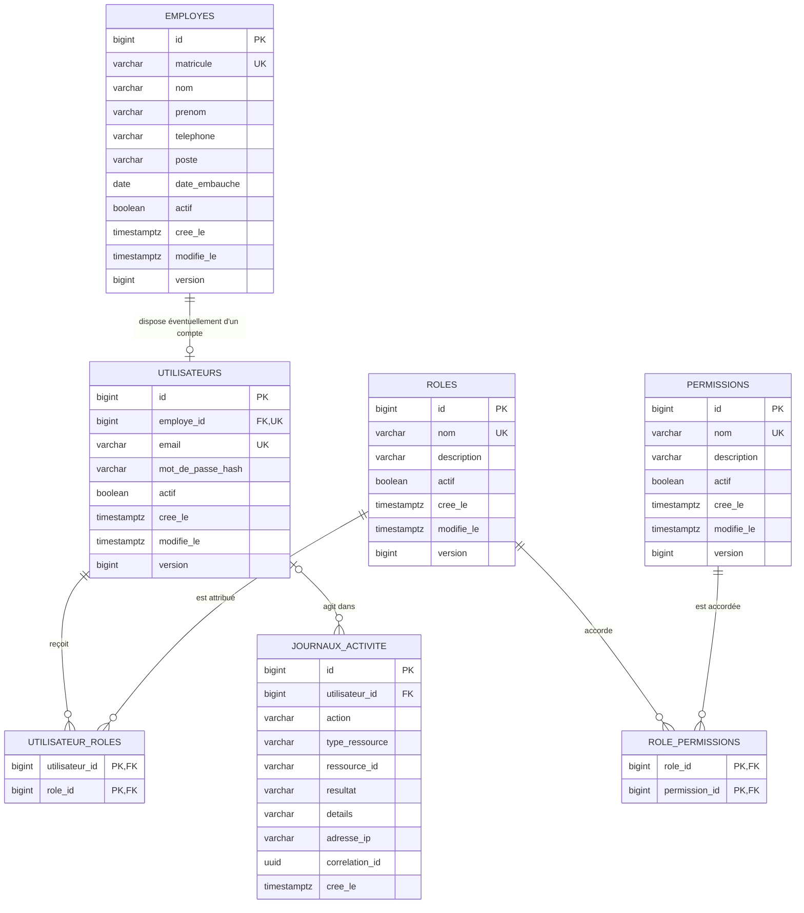

# Schéma sécurité et employés — étape 2

## Schéma relationnel

## Invariants

- L'e-mail est stocké en minuscules sans espaces périphériques et son index unique est insensible à la casse.
- Un employé possède au maximum un compte ; un compte référence obligatoirement un employé.
- Les noms des rôles et permissions sont uniques et correspondent aux enums Java.
- Les agrégats mutables (`Employe`, `Utilisateur`, `Role`, `Permission`) portent `actif`, les dates de création/modification et une version de verrouillage optimiste.
- Le journal d'activité est append-only. Son acteur est nullable pour les événements système et devient `NULL` si un compte devait être supprimé, afin de préserver le journal.
- Les tables d'association ont une clé primaire composée empêchant les doublons.
- Les champs texte obligatoires sont contrôlés comme non vides et toutes les tailles maximales sont imposées par PostgreSQL.

## Référentiels initiaux

La migration `V2` insère les six rôles prévus et sept permissions de gestion des utilisateurs, employés, rôles et journaux. Elle associe toutes les permissions à `ADMINISTRATEUR`, un sous-ensemble à `GERANT` et la consultation des employés aux rôles opérationnels.

La migration ne crée aucun employé, aucun utilisateur et aucune donnée de mot de passe.
