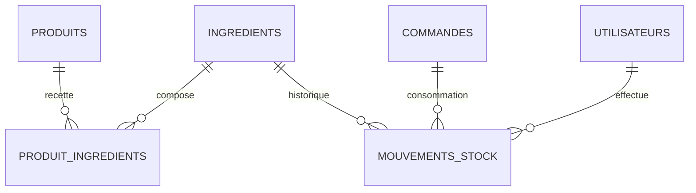

# Étape 10 — Ingrédients et stocks

## Décision de consommation

Le stock est déduit **une seule fois, lors de la confirmation de la commande**.
La confirmation constitue le premier engagement ferme sur les produits. Une
sortie est agrégée par ingrédient à partir des recettes et des quantités de
lignes de commande.

L'unicité SQL `(commande_id, ingredient_id)` rend cette consommation
idempotente. Une répétition, une concurrence ou une reprise ne peut pas créer
une deuxième sortie pour le même ingrédient et la même commande.

## Invariants

- `quantiteDisponible` n'est présente dans aucun DTO d'écriture ;
- sa variation passe exclusivement par `Ingredient.appliquer` et produit dans
  la même transaction un `MouvementStock` ;
- `ENTREE` et `RETOUR` augmentent le stock ;
- `SORTIE` et `PERTE` le diminuent ;
- `AJUSTEMENT` applique une variation signée ;
- `AJUSTEMENT` et `PERTE` exigent un motif ;
- les quantités utilisent `NUMERIC(14,3)` et `BigDecimal` sans arrondi implicite ;
- une quantité associée à l’unité `UNITE` est toujours un nombre entier : seuil,
  recette, mouvement, solde disponible, achat et réception ;
- un stock inférieur ou égal au seuil est signalé par `stockFaible=true`.

Le stock négatif est refusé par défaut. L'autorité exceptionnelle
`STOCK_NEGATIF_AUTORISER` est attribuée uniquement au rôle `ADMINISTRATEUR`.
Même dans ce cas, la variation reste obligatoirement tracée par un mouvement.

## Concurrence et idempotence

Chaque mouvement verrouille pessimiste l'ingrédient avant de lire puis
modifier son solde. `Ingredient` et `ProduitIngredient` possèdent aussi un
`@Version`. Les mouvements manuels exigent un en-tête UUID `Idempotency-Key` ;
une réutilisation avec un autre contenu est refusée.

## Autorisations

- `STOCK_CONSULTER` : `ADMINISTRATEUR`, `GERANT`, `RESPONSABLE_STOCK`, `CUISINE` ;
- `STOCK_GERER` : `ADMINISTRATEUR`, `GERANT`, `RESPONSABLE_STOCK` ;
- `STOCK_NEGATIF_AUTORISER` : `ADMINISTRATEUR` uniquement.

## Routes

- `POST/GET/PUT /api/stock/ingredients`
- `PUT/GET /api/stock/produits/{produitId}/recette`
- `DELETE /api/stock/produits/{produitId}/recette/{ingredientId}?version=` : retire une association avec contrôle de concurrence
- `POST /api/stock/mouvements`
- `GET /api/stock/mouvements?ingredientId=&type=&page=&taille=` : historique paginé, trié du plus récent au plus ancien

## Schéma

